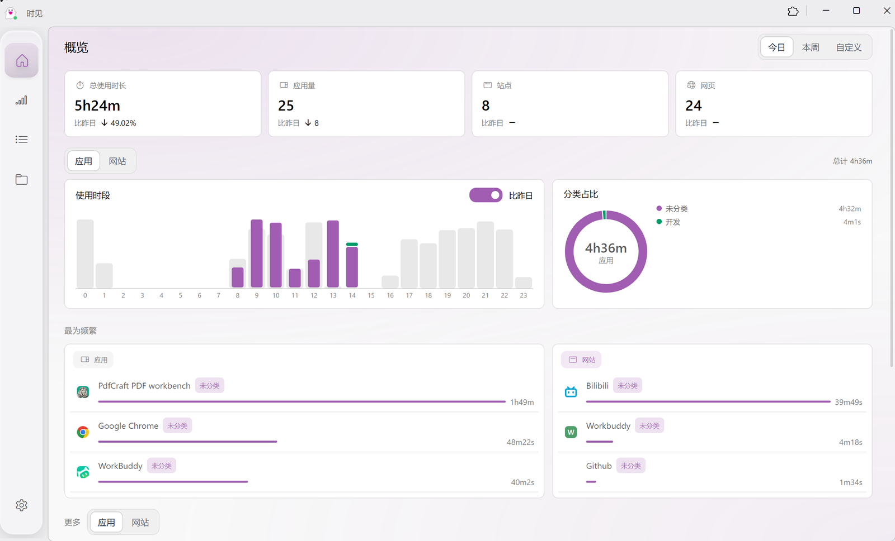
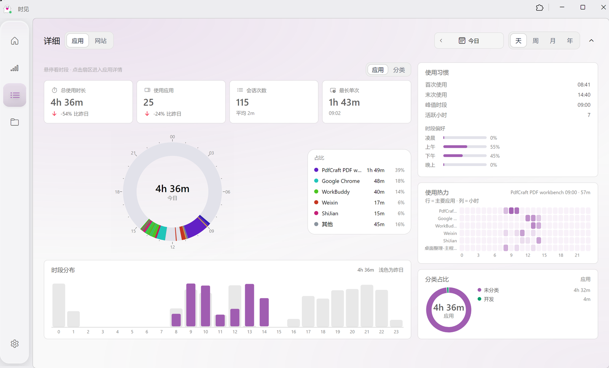
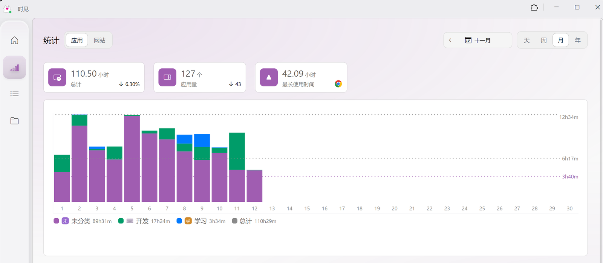
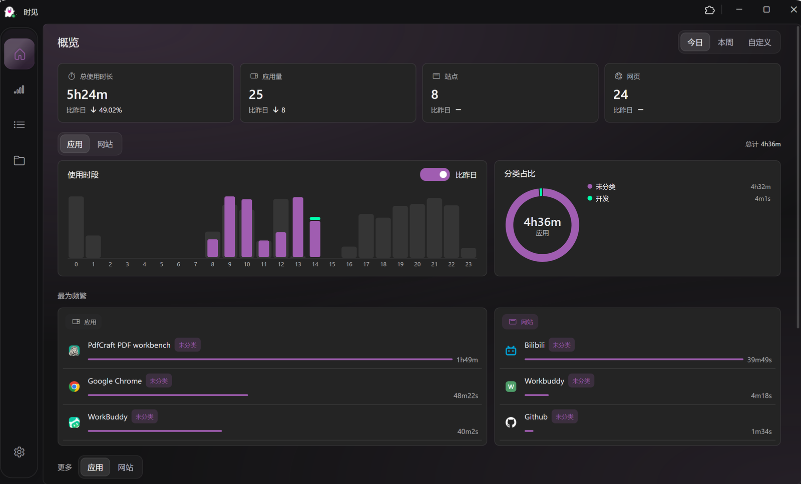
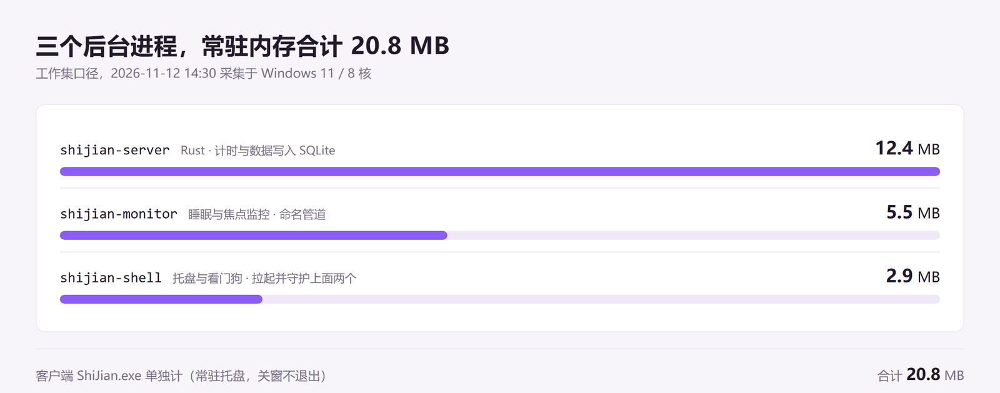

# 时见 ShiJian

> 在你自己的电脑上，记下每一分钟花在了哪个软件、哪个网站上。

时见是一款**本地优先**的屏幕使用时间统计工具，支持 Windows 与 macOS。数据只落在本机 SQLite 里，不上传、不联网、不需要账号。

界面用 .NET 10 AOT + Avalonia 12 写的，后台采集用 Rust（macOS 的监控是 Swift）。客户端只负责展示，采集与存储交给三个常驻后台进程，加起来大约 21 MB 内存。

<p align="center">
  
  
</p>
<p align="center">
  
  
</p>

## 它能给你什么

- **应用 + 网站一起算**：前台窗口的焦点切换会被逐次记录；装了浏览器扩展之后，网页访问时长按标签页真实活跃时间统计，不再靠「浏览器开着就算」。
- **看得清「什么时候」在干什么**：详细页的环形时钟把一天 24 小时画成一圈，扇区就是真实使用时段，点一下进应用详情。
- **能对比**：所有柱图都能叠一根「昨日 / 上一周期」的淡色柱，环比直接写在卡片上。
- **能分类**：应用和网站都能打分类标签，概览、统计、详细三处的分类占比用同一套配色。
- **安静**：动效可以跟随系统的「减少动画」设置一键关掉；键盘能走完整个界面。

## 功能

### 概览

- 四张总览卡：总使用时长 / 应用量 / 站点 / 网页，前两项带「比昨日」环比
- 使用时段堆叠柱图（按分类上色），可开关「比昨日」对比柱
- 分类占比环形图，中心是该周期总时长
- 「最为频繁」双列榜单（应用 / 网站），带分类徽章，点徽章直接进该分类的汇总页
- 周期支持今日 / 本周 / **自定义起止日期**（单日按小时、多日按天，对比基准取等长的上一个区间）

### 统计

- 应用 / 网站两个维度，天 / 周 / 月 / 年四种粒度
- 柱图点击选中后下钻到该时段明细
- 分类雷达图、最频繁榜单
- 网站维度有独立的一套网站分类体系

### 详细（数据看板）

- **环形时钟**：圆周就是周期（日 = 24 小时、周 = 7 天、月 = 当月天数、年 = 12 个月），扇区为真实使用时段，悬停看时间与名称，点击进应用详情
- 四张指标卡：总使用时长 / 使用应用（网站）/ 会话次数（浏览记录）/ 最长单次，前两项带环比
- 时段分布柱图，叠「上一周期」对比
- 使用习惯：首次 / 末次使用、峰值时段、活跃小时 · 天数 · 月份、时段偏好（凌晨 / 上午 / 下午 / 晚上）
- 使用热力：日 = 应用 × 小时、周 = 星期 × 小时、月 = 日历热力、年 = 月 × 日
- 分类占比环形图
- 响应式：窗口变窄收掉右侧洞察栏，变矮收掉底部柱图，保证表盘还有直径

### 其它

- 分类页与分类汇总页，分类维度贯穿全站
- 全局搜索（应用 / 网站 / 分类）
- 主题：跟随系统 / 浅色 / 深色 / 蔚蓝，主题色可自定义
- 界面动效开关：跟随系统 / 始终开启 / 始终关闭
- 键盘导航：`Esc` 返回上一页；侧边栏 `Tab` 可进、上下键换项、`Enter` 激活；周期与维度切换左右键；图表获得焦点后左右键切换选项并显示焦点环
- 空态与加载态统一：加载中显示骨架，而不是先闪一下「暂无数据」

## 下载与安装

到 [Releases](https://github.com/Purestblues/shijian/releases) 下载最新版：

| 平台 | 产物 | 说明 |
| --- | --- | --- |
| Windows | `ShiJian-*-Setup.exe` | 安装版，可自选目录，会注册开机自启 |
| Windows | `ShiJian-*-win-x64.zip` | 绿色版，解压即用，需要自己 `shijian-shell install` 注册自启 |
| macOS | `ShiJian-*-macos-arm64.dmg` | Apple Silicon；后台组件与安装脚本在 `ShiJianTools/` 里 |

> macOS 产物目前只验证过「能构建」，没有实机跑过。Windows 是逐项实测过的。

首次启动后，托盘里会出现时见的图标。后台的 `shijian-server` 与 `shijian-monitor` 由 `shijian-shell` 看门狗自动拉起并守护，**不需要也不应该手动启动**。

浏览器扩展（`shijian-browser-extension/`，Manifest V3）需要手动加载：打开 `chrome://extensions` → 开发者模式 → 「加载已解压的扩展程序」，选构建产物目录。扩展通过本机 WebSocket（默认 `127.0.0.1:8908`）把网页活跃时间推给 server。

## 架构

```
ShiJian.exe (Avalonia, .NET 10 AOT)   ← 只负责展示，随时可关
        │ HTTP 127.0.0.1:37091
        ▼
shijian-server (Rust)                 ← 计时、汇总、写 SQLite
        ▲ 命名管道                ▲ WebSocket 8908
        │                         │
shijian-monitor (Rust/Swift)   浏览器扩展 (ShiJian Web Sentry)
  焦点切换 / 睡眠监控
        ▲
        │ 由它拉起并守护上面两个
shijian-shell (Rust)                  ← 托盘 + 看门狗
```

| 组件 | 语言 | 职责 |
| --- | --- | --- |
| `ShiJian.Client` | C# / Avalonia | 客户端界面，307 个 `.cs`、67 个 `.axaml` |
| `shijian-server` | Rust | 数据访问接口，接收计时数据并写入 SQLite |
| `shijian-monitor` | Rust（Windows）/ Swift（macOS） | 监控应用睡眠与焦点切换，走命名管道与 server 通讯 |
| `shijian-shell` | Rust | 创建托盘，拉起并守护 server 与 monitor，做到客户端随用随关 |
| `shijian-browser-extension` | TypeScript | 网页活跃时长采集 |
| `shijian-webui` | Svelte + Vite | 浏览器扩展的弹窗界面 |
| `shijian-plugin-sdk` / `shijian-plugins` | Rust | 插件系统与内置插件（提醒等） |
| `shijian-installer` | Rust | Windows 安装器与 macOS DMG 打包 |
| `ShiJian.Tests` | xunit v3 + Avalonia.Headless | 79 个用例，CI 里先跑测试再打包 |

## 资源占用

三个后台进程常驻合计约 21 MB（工作集口径，Windows 11 / 8 核，2026-11-12 实测）：



客户端 `ShiJian.exe` 单独计，关掉窗口不会退出（常驻托盘，从托盘唤醒是秒开）。

## 常见问题

### 客户端提示「无法连接到服务端」

本质是后台进程没在运行。正常情况下 server 与 monitor 由 `shijian-shell` 自动拉起并守护，**只需确保 `shijian-shell` 在运行即可**。

若 server 自身异常（端口被占用、数据库损坏）导致启动即退出，看门狗虽会自动重试（间隔 5 秒起、退避至最长 30 秒），但服务始终不可用，此时应从 server 日志定位根因。

- **开机自启失效**：Windows 检查任务计划中 **ShiJianShell** 任务的路径是否与安装目录一致；Setup 安装器与绿色版均可用管理员终端 `shijian-shell install` 补注册。macOS 运行 `/Applications/ShiJianTools/install-launchagent.sh`
- **端口占用**：server 默认占 `127.0.0.1:37091`，浏览器扩展 WebSocket 占 `8908`。若 37091 被占用，可设置环境变量 `SHIJIAN_SERVER` 换端口（如 `http://127.0.0.1:37100`，客户端与 server 均读取该变量）
- **日志位置**：按 `shijian-server.YYYY-MM-DD.log` 按天滚动。macOS 在 `~/Library/Logs/ShiJian/`；Windows 绿色版在程序目录的 `Logs\`（该目录不可写时不落盘，只输出到标准流）。插件与 shell 日志在同一目录，可用 `SHIJIAN_LOG_DIR` 覆盖

## 从源码构建

需要 .NET 10 SDK；后台组件与安装器需要 Rust 工具链，Windows 上还需要 MSVC 链接器（VS Build Tools）。macOS 的 monitor 需要 Swift。

```powershell
# 客户端（调试版）
.\script\dev-run.ps1              # 编译并启动
.\script\dev-run.ps1 -NoBuild     # 跳过编译直接启动

# 测试
dotnet test ShiJian.Tests/ShiJian.Tests.csproj -c Release

# 后台组件（每个 crate 独立，没有根 workspace）
cd shijian-server && cargo build --release
cd ../shijian-monitor-windows && cargo build --release
cd ../shijian-shell && cargo build --release
```

- 开发运行时的数据目录是 `ShiJian.Client\bin\Debug\net10.0\`；图标目录为空时脚本会从安装目录（默认 `C:/Program Files/ShiJian`）复制 `Data/AppIcons` 与 `WebFavicons`，安装位置不同用 `-InstallDir` 指定
- 调试版直接连本机已在运行的 `shijian-server`（`127.0.0.1:37091`），不需要另起后端
- DEBUG 构建没有单实例锁，可与安装版同时运行；Release 构建有互斥锁，不能与安装版共存

### 发版

两个脚本都在 `script/` 下，需要 Windows PowerShell 5.1 及以上。

| 脚本 | 用途 |
| --- | --- |
| `script/prepare-release.ps1` | 按上一个 tag 自动递增版本号 + 用区间提交生成 release notes 草稿 |
| `script/release.ps1` | 一条命令打 tag 并触发 GitHub Actions 发 Release（版本号可省略，自动递增） |

```powershell
.\script\prepare-release.ps1            # 算出版本号 + 生成 notes 草稿到 .tmp/
.\script\prepare-release.ps1 -Apply     # 确认后的草稿写进 release_notes.txt
.\script\release.ps1 -DryRun            # 只预检，打印将执行的命令
.\script\release.ps1 -Commit -Watch     # 发版并等待构建完成
```

预检会拦下这些情况：不在 `main` 分支、工作区不干净（除非加 `-Commit`）、tag 已存在、Release 已存在。

> ⚠️ 在 fork 上 `git push` 一个 tag **不会**触发 Actions，脚本内部改用
> `gh workflow run release.yml --ref <tag>`；`--ref` 必须指向 tag，`github.ref` 才是 `refs/tags/...`，
> workflow 里的 release job 才会执行并上传产物。

> 本地打不出 `Setup.exe`：安装器（cargo）与客户端 AOT 发布都需要 MSVC 链接器，
> 因此发版统一走 GitHub Actions 的 windows-latest / macos-latest。

## 数据兼容

- 1.2.0 前支持 Tai 最新版本的 db 文件，1.2.0 及后的新版本暂不确定；当前程序对旧版数据有较完整的迁移步骤，理论上支持
- 迁移前请备份 db 文件

## 关于这个 fork

本仓库是 [NLick47/Taix](https://github.com/NLick47/Taix) 的个人 fork（上游 [Tai](https://github.com/Planshit/Tai) 的 .NET 10 + Avalonia + Rust 全面迁移）。2026-11 起改名为**时见 / ShiJian**，并**停止同步上游**：基线仍是上游 v1.3.4，之后不再 rebase，`LICENSE` 与上游署名照旧保留。

改动集中在客户端。相对上游 v1.3.4，目前已有的变化：

- **概览页重做**：总览卡（带比昨日 / 比上周）、使用时段堆叠柱图、分类占比环形图，图表区可在应用 / 网站之间切换
- **周期支持自定义起止日期**，对比基准取等长的上一个区间
- **分类维度贯穿全站**：榜单 / 卡片显示分类徽章，点徽章进该分类汇总
- **时段对比**：24 小时柱图叠加「昨日同小时」淡色柱，可开关
- **详细页改用环形时钟**，去掉原来的多轨泳道；新增指标卡、时段分布、使用习惯、使用热力、分类占比组成的看板，窄窗口自动收起右侧栏
- **图表配色统一**：改按 WCAG 相对亮度算对比度（目标 3:1），深色主题下不再偏暗；「未分类」跟随主题色
- **视觉体系 v1**：8px 圆角 + 1px 发丝边 + 零阴影，明暗两套色板重做，主题色默认改为紫
- **动效 v2**：页面淡入、总览卡错峰、图表生长、数字滚动、展开收起高度动画；动效开关跟随系统的「减少动画」偏好
- **键盘导航**：`Esc` 返回、侧边栏与图表的方向键切换、榜单方向键选中 + `Enter` 进详情
- **空态与加载态统一**（骨架屏），颜色跟随主题
- **窗口修复**：双击标题栏最大化 / 还原、窗口最外缘可拖拽缩放、不再把满屏尺寸当成正常尺寸保存
- **图标修复**：客户端改在 `<exe>\Data\AppIcons` 查找；0 字节 / 解码失败的网站图标降级为域名首字母色块；修复图标缓存淘汰释放仍在渲染的位图导致的闪退
- **性能**：首屏请求从 16 个降到 10 个，`AppChanged` 事件去抖 100ms → 500ms

已知问题与后续计划见 [`docs/ROADMAP.md`](docs/ROADMAP.md)，设计与动效的目标与差距见 [`docs/DESIGN-SP-ALIGN.md`](docs/DESIGN-SP-ALIGN.md)。

## 改名说明

2026-11 起本项目由 **Taix** 改名为**时见 / ShiJian**：产品显示名为「时见」，英文界面显示 ShiJian，代码标识统一为 `ShiJian` / `shijian-*`。只碰标识，不动业务逻辑。

| 项目 | 旧 | 新 |
| --- | --- | --- |
| 程序 / 目录 / crate | `Taix`、`taix-*` | `ShiJian`、`shijian-*` |
| 安装目录（Windows） | `…\Taix` | `…\ShiJian`（Setup 仍可自选） |
| 数据目录（macOS） | `~/Library/Application Support/Taix` | `~/Library/Application Support/ShiJian` |
| 计划任务 / LaunchAgent | `TaixShell` / `com.taix.shell` | `ShiJianShell` / `com.shijian.shell` |
| 环境变量 | `TAIX_SERVER` / `TAIX_LOG_DIR` | `SHIJIAN_SERVER` / `SHIJIAN_LOG_DIR` |
| 浏览器扩展 | Taix Web Sentry | ShiJian Web Sentry（需重新「加载已解压的扩展」，扩展 ID 会变） |
| 端口 | 37091（HTTP）/ 8908（WS） | 不变 |

**数据不会丢**：

- macOS：server 启动时把 `Application Support/Taix` 里缺失的条目补进 `ShiJian`（只补不覆盖），旧目录原地保留
- Windows：Setup 安装前会停掉旧进程、摘掉旧自启动项，并把旧安装目录的 `Data/` 合并进新目录；旧安装目录本身不删，确认新版本正常后可手动清理
- 旧的任务计划 / 注册表自启动项会一并清掉，不会出现新旧两份同时采集

## 许可

沿用上游 [LICENSE](LICENSE)，署名与版权声明照旧保留。
